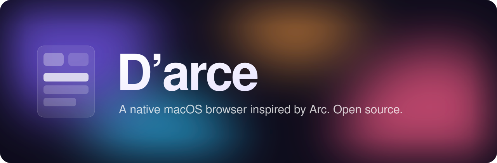

<p align="center">
  
</p>

<p align="center">
  <a href="../../releases/latest"></a>
</p>

<p align="center">
  
  
  
  
  
</p>

<p align="center">
  <b>Arc is going away. The ideas don't have to.</b><br>
  Spaces, a sidebar that cleans itself up, split view and a command bar for everything,<br>
  rebuilt from scratch in SwiftUI and AppKit. Open source, no account, no telemetry.
</p>

> [!WARNING]
> **D'arce is a work in progress.** Things are missing and some things will break. Try it, report bugs, send PRs, but keep your old browser around for now.

<!-- Hero screenshot goes here: docs/hero.png -->

## ✦ What's inside

<table>
  <tr>
    <td width="50%" valign="top">
      <h3>🗂 Sidebar &amp; Spaces</h3>
      Favorites, pinned tabs that remember their home URL, nested folders, and a separate Space for each part of your life, each with its own colors and icon. Drag any tab between Favorites, Pinned, folders, Today and other Spaces.
    </td>
    <td width="50%" valign="top">
      <h3>🧹 Auto-archive</h3>
      Today tabs you stop using archive themselves on a schedule you choose. Anything archived comes back with <kbd>⇧</kbd><kbd>⌘</kbd><kbd>T</kbd>.
    </td>
  </tr>
  <tr>
    <td valign="top">
      <h3>⌘ Command bar</h3>
      One box for URLs, search, open tabs, history, Spaces and actions. Press <kbd>⌘</kbd><kbd>T</kbd> and type.
    </td>
    <td valign="top">
      <h3>◫ Split view &amp; Peek</h3>
      Drop one tab onto another to put them side by side, up to four. A split shows as one row in the sidebar and is saved across launches. Links from pinned tabs open in a Peek, so the pin stays put.
    </td>
  </tr>
  <tr>
    <td valign="top">
      <h3>🎨 Themes</h3>
      One-, two- or three-color gradients per Space, rendered with Metal. Light and dark.
    </td>
    <td valign="top">
      <h3>⚡ Boosts, Notes &amp; Easels</h3>
      Arc's Boost editor: drag the color pad to retint any site, invert its lightness, pick one of 20 fonts, change text size and case, Zap away anything you click, or write your own CSS and JS. Plus local notes and page captures.
    </td>
  </tr>
  <tr>
    <td valign="top">
      <h3>🪟 Mini windows</h3>
      Like Little Arc. Make D'arce your default browser and links from other apps open in a small window; one click moves the page into your sidebar. <kbd>⌥</kbd><kbd>⌘</kbd><kbd>N</kbd> opens one any time.
    </td>
    <td valign="top">
      <h3>👤 Profiles &amp; private windows</h3>
      Separate cookies and logins per profile. Private windows keep nothing.
    </td>
  </tr>
  <tr>
    <td valign="top" colspan="2">
      <h3>🔨 Developer Mode</h3>
      Per site, like Arc (<kbd>⌃</kbd><kbd>D</kbd>, on by default for localhost): a striped bar with console, network and inspect buttons opening WebKit's Web Inspector, a dashed outline on the tab, and reload options to ignore the cache or clear cookies.
    </td>
  </tr>
  <tr>
    <td valign="top" colspan="2">
      <h3>🧩 Extensions</h3>
      Most Chrome extensions run: paste a Chrome Web Store link, or open an extension's store page and click <b>Add to D'arce</b> in site controls. Uses WebKit's Web Extensions engine (macOS 15.4+). Built on WebKit and SwiftUI; the download is about 2&nbsp;MB.
    </td>
  </tr>
</table>

## ⬇ Install

> Requires an **Apple Silicon Mac** running **macOS 14** or later.

1. Download the latest `.dmg` from **[Releases](../../releases/latest)**.
2. Open it and drag **D'arce** into **Applications**.
3. Launch it.

<details>
<summary><b>macOS says it can't verify the app?</b></summary>
<br>

D'arce isn't notarized by Apple yet. Open **System Settings → Privacy &amp; Security**, scroll down, and click **Open Anyway**. Or run:

```sh
xattr -dr com.apple.quarantine "/Applications/D'arce.app"
```
</details>

## ⌨ Shortcuts

The same keys as Arc, so muscle memory carries over.

| Tabs | | Spaces &amp; split view | |
|---|---|---|---|
| <kbd>⌘</kbd> <kbd>T</kbd> | Command bar / new tab | <kbd>⌃</kbd> <kbd>1</kbd> … <kbd>9</kbd> | Jump to a Space |
| <kbd>⌘</kbd> <kbd>L</kbd> | Edit the URL | <kbd>⌥</kbd> <kbd>⌘</kbd> <kbd>←</kbd> <kbd>→</kbd> | Previous / next Space |
| <kbd>⌃</kbd> <kbd>Tab</kbd> | Recent tab (hold <kbd>⌃</kbd> to go further back) | <kbd>⌃</kbd> <kbd>⇧</kbd> <kbd>=</kbd> | Add a split view pane |
| <kbd>⌥</kbd> <kbd>⌘</kbd> <kbd>↑</kbd> <kbd>↓</kbd> | Previous / next tab | <kbd>⌃</kbd> <kbd>⇧</kbd> <kbd>-</kbd> | Close the split view pane |
| <kbd>⌘</kbd> <kbd>1</kbd> … <kbd>9</kbd> | Go to tab 1–8 / last tab | <kbd>⌘</kbd> <kbd>S</kbd> | Show or hide the sidebar |
| <kbd>⌘</kbd> <kbd>D</kbd> | Pin or unpin | <kbd>⌘</kbd> <kbd>N</kbd> / <kbd>⇧</kbd> <kbd>⌘</kbd> <kbd>N</kbd> | New window / private window |
| <kbd>⌘</kbd> <kbd>O</kbd> | Mini window → open in D'arce | <kbd>⌥</kbd> <kbd>⌘</kbd> <kbd>N</kbd> | New mini window |
| <kbd>⌘</kbd> <kbd>W</kbd> · <kbd>⌘</kbd> <kbd>Z</kbd> | Close the tab (pins stay in the sidebar) · bring it back | <kbd>⌘</kbd> <kbd>Y</kbd> | History |
| <kbd>⇧</kbd> <kbd>⌘</kbd> <kbd>T</kbd> | Reopen the last archived tab | <kbd>⇧</kbd> <kbd>⌘</kbd> <kbd>J</kbd> | Downloads |
| <kbd>⇧</kbd> <kbd>⌘</kbd> <kbd>K</kbd> | Clear all Today tabs | <kbd>⌘</kbd> <kbd>F</kbd> | Find in page |
| <kbd>⇧</kbd> <kbd>⌘</kbd> <kbd>C</kbd> | Copy the URL | <kbd>⌘</kbd> <kbd>+</kbd> <kbd>-</kbd> <kbd>0</kbd> | Zoom |
| <kbd>⌥</kbd> <kbd>⇧</kbd> <kbd>⌘</kbd> <kbd>C</kbd> | Copy the URL as Markdown | <kbd>⌘</kbd> <kbd>[</kbd> <kbd>]</kbd> | Back / forward |

## 👆 Trackpad gestures

| Gesture | Where | What it does |
|---|---|---|
| Two-finger swipe | Sidebar | Slide to the next or previous Space, with its colors fading in as you go |
| Two-finger swipe | Page | Back / forward |
| Pinch | Page | Zoom |
| Two-finger double-tap | Page | Smart zoom |

## 🧭 Roadmap

- [x] Sidebar, Spaces, Favorites, pins, folders
- [x] Auto-archive and restore
- [x] Command bar
- [x] Split view and Peek
- [x] Space themes
- [x] Boosts, Notes, Easels
- [x] Profiles and private windows
- [x] Chrome Web Store extensions (macOS 15.4+)
- [ ] Chromium engine
- [ ] Sync between Macs
- [ ] Passwords and passkeys
- [ ] Restore windows on relaunch
- [ ] Notarized builds
- [ ] Intel Macs

## 🔒 Your data stays on your Mac

No account and no telemetry. Tabs and settings live in `~/Library/Application Support/Darce`. Website data uses WebKit's per-profile stores. Private windows write nothing to disk except files you choose to save.

## 🛠 Build from source

Needs Xcode with Swift 6. There are no package dependencies.

```sh
git clone https://github.com/vinny380/darce.git && cd darce
bash scripts/run.sh        # build and launch (data kept in .local/)
bash scripts/package.sh    # release .dmg + .zip in dist/
```

<details>
<summary>Tests and project layout</summary>
<br>

```sh
swift test
bash scripts/smoke.sh
bash scripts/network-smoke.sh
```

```text
Sources/BrowserCore/       Engine-independent models and stores
Sources/BrowserPrototype/  The SwiftUI/AppKit app
Sources/BrowserTheme/      Palette and Metal theme renderer
Tests/                     Regression tests
scripts/                   Build, package and smoke tests
```
</details>

## 🤝 Contributing

Issues and pull requests are welcome. If Arc did something you can't live without, open an issue and say what it was.

---

<p align="center">
  <sub>MIT licensed · Not affiliated with The Browser Company · Made by people who miss Arc</sub>
</p>
